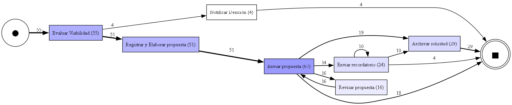
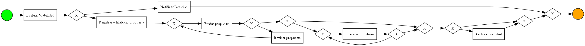

# Minería de procesos de la etapa de negociación (consigna 4.4)

Este documento reúne la adaptación de los scripts provistos, los datos utilizados, los resultados y la conclusión del análisis. Las instrucciones para reproducirlo están en la sección 7 del `README.md`.

## 1. Adaptación de los scripts provistos

La consigna (§4.4) indica usar los scripts provistos por la cátedra adaptándolos al proceso implementado. Los originales (`exportar_history_168631741028.py` y `analizar_168631741022.py`) no forman parte del repositorio; las versiones adaptadas son `mineria/exportar_history.py` y `mineria/analizar.py`. La lógica original (consulta paginada, exclusión de instancias borradas, orden estable, variantes, DFG y descubrimiento inductivo) no se modificó; las tablas siguientes detallan todos los cambios.

### `exportar_history.py`

| Qué | Antes | Ahora | Por qué |
|---|---|---|---|
| `BASE_URL` | `http://localhost:8080/flowable-ui/process-api` | `http://localhost:8080/flowable-rest/service` (se puede cambiar con la variable `FLOWABLE_REST`) | En este proyecto la API REST es el contenedor `flowable-rest` (8080, ruta `/flowable-rest/service`); `flowable-ui` está en el 8081. |
| `PROCESS_KEY` | `processxor` | `Process_Curso` | ID del `<process>` de nuestro modelo. |
| `ACTIVIDADES` | vacío (todo) | los 17 IDs de la etapa de negociación (de *Solicitud recibida* a la respuesta de la empresa, sin la preparación) | La consigna 4.4 pide analizar sólo la negociación. Incluye eventos y compuertas: el filtro por tipo lo hace `analizar.py`. |
| `ARCHIVO_SALIDA` | `eventos.csv` en el directorio actual | `eventos.csv` junto al script | Que no dependa de desde dónde se lo ejecute. |
| Credenciales | siempre se preguntan | se toman de `FLOWABLE_USER` / `FLOWABLE_PASSWORD` si existen; si no, se preguntan igual | Poder repetir el análisis sin teclear. Con la clave de desarrollo es `rest-admin` / `test`. |
| `import os` | — | agregado | Necesario para lo anterior. |

### `analizar.py`

| Qué | Antes | Ahora | Por qué |
|---|---|---|---|
| Rutas de `eventos.csv`, `recorridos.png`, `modelo_descubierto.png` y `modelo_descubierto.bpmn` | relativas al directorio actual | junto al script (función `ruta()`) | Igual que arriba. |
| Salida por consola | sólo consola | consola **y** `resultados.txt` (clase `Duplicar`) | La consigna pide entregar "una captura de los resultados"; así queda el texto de la corrida. |
| `import os`, `import sys` | — | agregados | Necesarios para lo anterior. |

**Sin cambios, a propósito:** el filtro `tipo in ["userTask", "serviceTask"]`. Con él las tareas y los eventos de
mensaje o temporizador (aceptación, rechazo, solicitud de modificaciones, plazo) no entran en los recorridos; las
consecuencias se analizan en la sección 5 (limitaciones).

## 2. Datos analizados

**Datos:** 55 instancias terminadas de `Process_Curso`, generadas con `mineria/generar_historial.js` (mezcla de casos fija, plazos
acortados; no son ejecuciones de una institución real). **CSV:** `mineria/eventos.csv` (878 eventos, sólo la etapa de
negociación). **Análisis:** `mineria/analizar.py` (PM4Py), filtrado a tareas de usuario y automáticas como el script provisto.
Salida completa en `mineria/resultados.txt`; gráficos en `mineria/recorridos.png` y `mineria/modelo_descubierto.png`.

## 3. Los tres recorridos más frecuentes

| # | Casos | % | Recorrido (tareas) | Qué ocurrió en el proceso |
|---|---|---|---|---|
| 1 | 13 | 23,6 % | Evaluar Viabilidad → Registrar y Elaborar propuesta → Enviar propuesta → Archivar solicitud | Rechazo de la propuesta sin recordatorios previos |
| 2 | 12 | 21,8 % | Evaluar Viabilidad → Registrar y Elaborar propuesta → Enviar propuesta | La empresa aceptó (el curso siguió a la preparación, que queda fuera de este análisis) |
| 3 | 8 | 14,5 % | Evaluar Viabilidad → Registrar y Elaborar propuesta → Enviar propuesta → Enviar recordatorio → Enviar recordatorio → Archivar solicitud | Cierre por falta de respuesta tras los dos recordatorios |

Hay 9 recorridos distintos. Los otros seis suman 22 casos (40,0 %): 6 con una revisión y reenvío de la propuesta
(aceptada después), 4 con una revisión y rechazo, 4 con un recordatorio y aceptación, 4 no viables (*Evaluar
Viabilidad → Notificar Desición*), 2 con dos revisiones y 2 con una revisión y falta de respuesta. El grafo de sucesión directa (`recorridos.png`) muestra las frecuencias de cada flecha.

## 4. Comparación con el modelo BPMN

**Coincidencias.** El modelo descubierto reproduce la estructura de la negociación: *Evaluar Viabilidad* y una
bifurcación entre *Notificar Desición* (no viable) y *Registrar y Elaborar propuesta*; *Enviar propuesta*; el ciclo
*Revisar propuesta* → *Enviar propuesta* (modificaciones); el ciclo *Enviar recordatorio*; y *Archivar solicitud* como
cierre de rechazos y de faltas de respuesta. Todos los recorridos observados son caminos válidos del modelo: no hay
ninguna secuencia que el modelo prohíba. Los cuatro casos no viables (7,3 %) y los 29 que llegan a *Archivar
solicitud* (52,7 %) coinciden con los resultados que informa la consulta 4.3.1 (4 `NO_VIABLE`; 19 `RECHAZADO` y 10
`SIN_RESPUESTA`).

**Diferencias.**
- El modelo BPMN espera la respuesta con una compuerta basada en eventos (*Aceptación*, *Rechazo*, *Solicitud de
  modificaciones* y el temporizador de 5 días). Esos elementos no son tareas y no aparecen en los recorridos: el
  modelo descubierto no tiene la espera, sino compuertas exclusivas sin nombre que no se corresponden con las del
  diagrama.
- El modelo limita los recordatorios a dos por versión de la propuesta y reinicia el contador con cada versión. El
  modelo descubierto sólo ve un ciclo de *Enviar recordatorio* y lo permite repetir sin tope.
- El modelo distingue el rechazo del cierre por falta de respuesta; en el modelo descubierto ambos son un
  *Archivar solicitud*. Un rechazo con dos recordatorios previos tendría la misma secuencia de tareas que una falta de
  respuesta.
- La aceptación no deja ninguna tarea propia en la negociación: el recorrido "Evaluar → Registrar → Enviar" termina
  igual si la empresa aceptó o si la instancia sigue esperando.

## 5. Limitaciones del análisis
1. El filtro a `userTask` y `serviceTask` (el del script original) deja afuera los eventos de mensaje y de
   temporizador, donde está la decisión de la empresa. Incluirlos (`intermediateCatchEvent`) permitiría separar
   aceptación, rechazo, modificaciones y plazos, y verificar el tope de dos recordatorios.
2. El CSV registra qué se hizo y cuándo, no por qué. No hay datos para explicar las decisiones (el motivo de un
   rechazo, o si una modificación evitó un rechazo).
3. Los datos son sintéticos: las frecuencias dependen de la mezcla que fija el generador y los plazos se acortaron
   (8 s en vez de 5 días). Sirven para validar la herramienta y el método, no para sacar conclusiones sobre la
   institución. Con una muestra real habría que mirar también los tiempos entre actividades.
4. El análisis sólo cubre la negociación; la preparación en paralelo, la cancelación y la compensación no entran.
