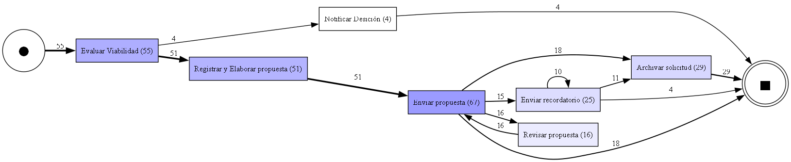
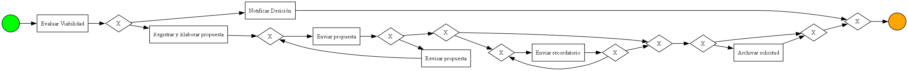

# Minería de procesos de la negociación (consigna 4.4)

**Datos:** 55 instancias terminadas de `Process_Curso`, generadas con `generar_historial.js` (mezcla de casos fija, plazos
acortados; no son ejecuciones de una institución real). **CSV:** `eventos.csv` (885 eventos, sólo la etapa de
negociación). **Análisis:** `analizar.py` (PM4Py), filtrado a tareas de usuario y automáticas como el script original.
Salida completa en `resultados.txt`; gráficos en `recorridos.png` y `modelo_descubierto.png`.

## Los tres recorridos más frecuentes

| # | Casos | % | Recorrido (tareas) | Qué ocurrió en el proceso |
|---|---|---|---|---|
| 1 (empate) | 12 | 21,8 % | Evaluar Viabilidad → Registrar y Elaborar propuesta → Enviar propuesta → Archivar solicitud | Rechazo de la propuesta sin recordatorios previos |
| 1 (empate) | 12 | 21,8 % | Evaluar Viabilidad → Registrar y Elaborar propuesta → Enviar propuesta | La empresa aceptó (el curso siguió a la preparación, que queda fuera de este análisis) |
| 3 | 8 | 14,5 % | Evaluar Viabilidad → Registrar y Elaborar propuesta → Enviar propuesta → Enviar recordatorio → Enviar recordatorio → Archivar solicitud | Cierre por falta de respuesta tras los dos recordatorios |

Hay 10 recorridos distintos. Los otros siete suman 23 casos (41,8 %): 6 con una revisión y reenvío de la propuesta
(aceptada después), 4 con una revisión y rechazo, 4 con un recordatorio y aceptación, 4 no viables (*Evaluar
Viabilidad → Notificar Desición*), 2 con dos revisiones, 2 con una revisión y falta de respuesta, y 1 con un
recordatorio y rechazo. El grafo de sucesión directa (`recorridos.png`) muestra las frecuencias de cada flecha.

## Comparación con el modelo BPMN

**Coincidencias.** El modelo descubierto reproduce la estructura de la negociación: *Evaluar Viabilidad* y una
bifurcación entre *Notificar Desición* (no viable) y *Registrar y Elaborar propuesta*; *Enviar propuesta*; el ciclo
*Revisar propuesta* → *Enviar propuesta* (modificaciones); el ciclo *Enviar recordatorio*; y *Archivar solicitud* como
cierre de rechazos y de faltas de respuesta. Todos los recorridos observados son caminos válidos del modelo: no hay
ninguna secuencia que el modelo prohíba. Los cuatro casos no viables (7,3 %) y los 29 que llegan a *Archivar
solicitud* (52,7 %) coinciden con los resultados que informa la consulta 4.3.1 (4 `NO_VIABLE`; 19 `RECHAZADO` y 10
`SIN_RESPUESTA`).

**Diferencias.**
- El modelo BPMN espera la respuesta con una compuerta basada en eventos (*Aceptación*, *Rechazo*, *Solicitud de
  modificaciones* y el temporizador de 5 días). Esos elementos no son tareas y no aparecen en los recorridos: el
  modelo descubierto no tiene la espera, sino compuertas exclusivas sin nombre que no se corresponden con las del
  diagrama.
- El modelo limita los recordatorios a dos por versión de la propuesta y reinicia el contador con cada versión. El
  modelo descubierto sólo ve un ciclo de *Enviar recordatorio* y lo permite repetir sin tope.
- El modelo distingue el rechazo del cierre por falta de respuesta; en el modelo descubierto ambos son un
  *Archivar solicitud*. Un rechazo con dos recordatorios previos tendría la misma secuencia de tareas que una falta de
  respuesta.
- La aceptación no deja ninguna tarea propia en la negociación: el recorrido "Evaluar → Registrar → Enviar" termina
  igual si la empresa aceptó o si la instancia sigue esperando.

**Limitaciones del análisis.**
1. El filtro a `userTask` y `serviceTask` (el del script original) deja afuera los eventos de mensaje y de
   temporizador, donde está la decisión de la empresa. Incluirlos (`intermediateCatchEvent`) permitiría separar
   aceptación, rechazo, modificaciones y plazos, y verificar el tope de dos recordatorios.
2. El CSV registra qué se hizo y cuándo, no por qué. No hay datos para explicar las decisiones (el motivo de un
   rechazo, o si una modificación evitó un rechazo).
3. Los datos son sintéticos: las frecuencias dependen de la mezcla que fija el generador y los plazos se acortaron
   (8 s en vez de 5 días). Sirven para validar la herramienta y el método, no para sacar conclusiones sobre la
   institución. Con una muestra real habría que mirar también los tiempos entre actividades.
4. El análisis sólo cubre la negociación; la preparación en paralelo, la cancelación y la compensación no entran.
